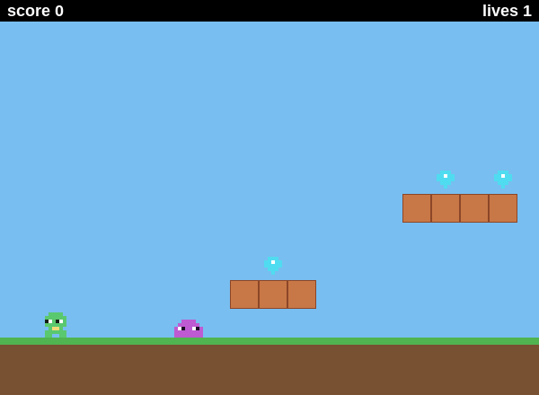
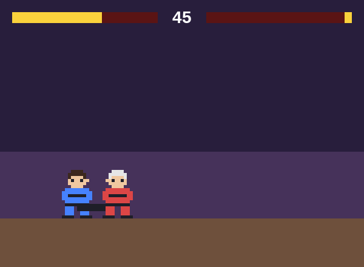
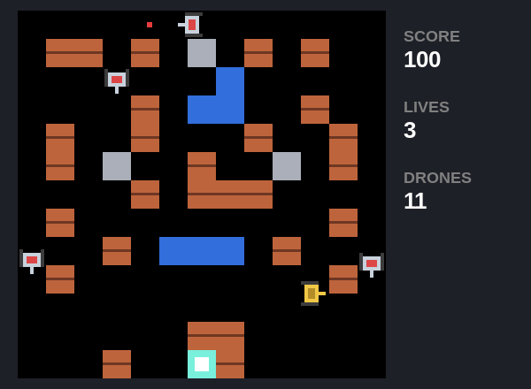
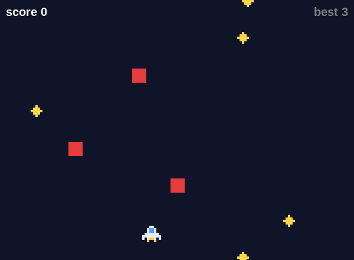
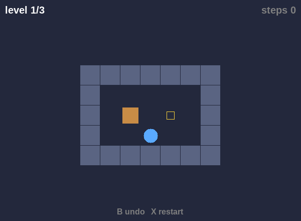
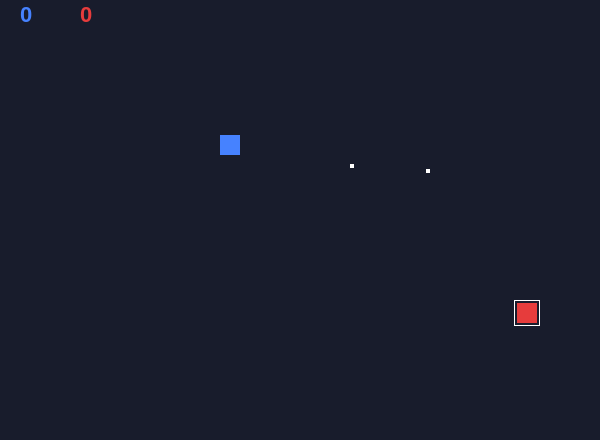
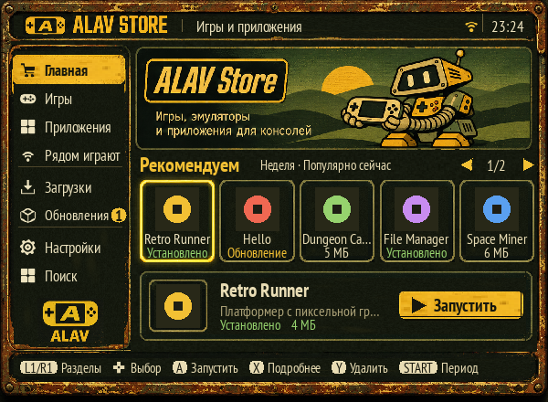
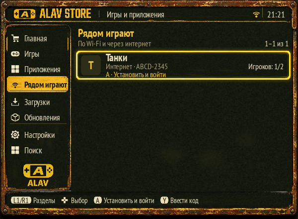
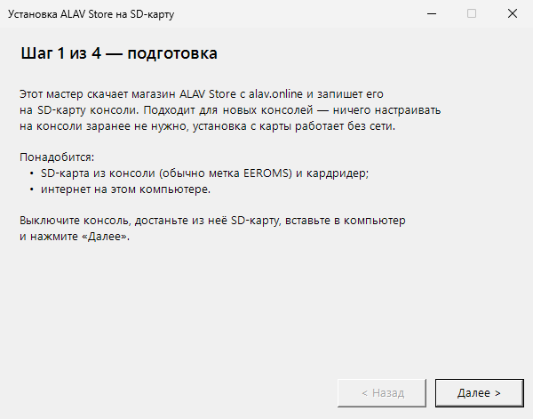
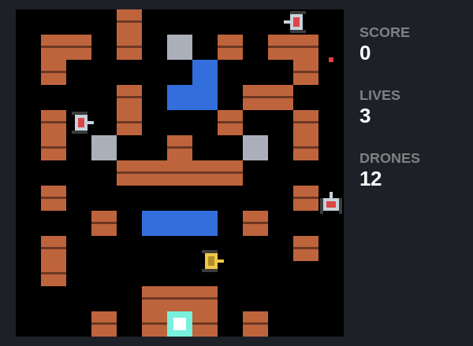

# ALAV Gamekit — игры для R36T и других портативных консолей силами ИИ-агентов

Набор, с которым ИИ-агент (Claude Code, Codex, Cursor и любой другой) делает настоящую игру для
портативной ретро-консоли: **R36T** и похожих консолей на **RK3326** с **EmuELEC** и магазином
**[ALAV Store](https://alav.online/apps/showcase?appId=e1cbd076-0ec2-48a6-92da-e4c0787219fc)**.
Цель — чтобы даже слабая модель довела игру до рабочего состояния: одна маленькая библиотека на Python,
одна команда проверки, готовые примеры по жанрам и одна инструкция для агента — [AGENTS.md](AGENTS.md).

*A kit that lets AI coding agents (even weak ones) build working games for the R36T and similar
RK3326 / EmuELEC handheld retro consoles running [ALAV Store](https://alav.online/apps/showcase?appId=e1cbd076-0ec2-48a6-92da-e4c0787219fc):
one tiny Python library, one check command, genre examples, one instruction file — [AGENTS.md](AGENTS.md).*

| | | |
| --- | --- | --- |
|  |  |  |
|  |  |  |

*Игры-примеры из набора: все нарисованы кодом, графика — спрайты из текста.*

## Консоли и платформа

| | |
| --- | --- |
| Эталонная консоль | **R36T** (на ней сделаны все замеры) |
| Процессор | Rockchip **RK3326**, 4 медленных ядра — примерно в 30 раз медленнее ПК |
| Прошивка | **EmuELEC**; игры запускаются из раздела **Ports** |
| Экран игры | логический 600×440; набор сам растягивает его на реальный экран с сохранением пропорций |
| Язык | чистый **Python 3.11** + SDL2 (уже есть на консоли); на консоль ничего ставить не нужно |
| Разработка | Windows, Linux или macOS с Python 3.11+ |

Другие консоли на RK3326 с EmuELEC (например, R36S) устроены так же, но проверялась только R36T.

## ALAV Store на консоли

**[ALAV Store](https://alav.online/apps/showcase?appId=e1cbd076-0ec2-48a6-92da-e4c0787219fc)** —
магазин игр и приложений прямо на консоли: каталог, обновления, сетевая игра «Рядом играют», режим
разработчика для отладки по Wi-Fi. Игры из этого набора можно выложить туда же (см. «Публикация»).

| | |
| --- | --- |
|  |  |

### Установка магазина: мастер для Windows

Магазин ставится на новую консоль без SSH и без сети на самой консоли — мастером установки:

1. Откройте [карточку ALAV Store](https://alav.online/apps/showcase?appId=e1cbd076-0ec2-48a6-92da-e4c0787219fc)
   и нажмите **«Скачать приложение»** — скачается ZIP с мастером (всегда актуальной версии).
2. Распакуйте и дважды щёлкните `Install ALAV Store.cmd`. Нужен только встроенный PowerShell
   (Windows 8/10/11; Windows 7 — с WMF 3+).
3. Выключите консоль, вставьте её SD-карту в компьютер (обычно метка **EEROMS**), выберите её в мастере.
   Мастер сам скачает магазин, проверит SHA-256 и запишет его на карту.
4. Верните карту в консоль, в разделе **Ports** запустите **Install ALAV Store** — через минуту
   меню перезапустится и появится **ALAV Store**.



Если карта поддельная (раздел больше, чем реально вмещает карта), мастер это заметит и предложит
«Урезать раздел…».

## Как сделать игру

1. Установите Python 3.11+. Больше ничего ставить не нужно: SDL2 набор скачает сам при первом запуске.
2. Если набор лежит внутри вашего проекта (например, `мой-проект/alav-gamekit/`), один раз выполните в
   папке набора `python tool.py setup`. Команда положит инструкции для агента в папку проекта и создаст
   там каталог `games/` для ваших игр — после этого новая сессия агента в папке проекта сразу понимает,
   что здесь делают игры для консолей с ALAV Store. Агент, которого попросили «скачать и подготовить
   окружение», выполнит эту команду сам: это записано в `AGENTS.md`.
3. Откройте папку проекта (или сам набор) в ИИ-агенте и попросите, например:
   «Сделай игру для консоли: космический шутер с боссом».
   Агент прочитает [AGENTS.md](AGENTS.md) и пройдёт шаги: создать → написать → проверить → упаковать.
4. Поставьте игру на консоль одним из способов:
   - скопируйте `dist/<Название>.sh` в папку `ports_scripts` на SD-карте и запустите его из **Ports** —
     это установщик игры: он ставит её (или обновляет, сохраняя прогресс) и добавляет в меню;
   - или отправьте игру по Wi-Fi через режим разработчика (ниже);
   - или опубликуйте её в ALAV Store.

Выход из любой игры — **SELECT+START**.

## Что внутри

| Путь | Назначение |
| --- | --- |
| [AGENTS.md](AGENTS.md) | Вся инструкция для агента: шаги, правила, полный API, сеть, типичные ошибки |
| `kit/alav.py` | Библиотека: экран 600×440, спрайты из текста, кнопки, звук, сохранения, сеть |
| `tool.py` | `setup` / `new` / `run` / `check` / `pack` / `deploy` (через режим разработчика ALAV Store) / `publish` (в каталог ALAV Store) |
| [examples/](examples/README.md) | Примеры по жанрам: аркада, платформер, файтинг, танки, головоломка, сетевая игра |
| `games/` | Сюда агент кладёт новые игры (после `setup` — каталог `games/` в папке проекта, вне набора) |
| `.claude/skills/` | Скилы Claude Code: new-game, check-game, ship-game, network-game |

## Команды

```
python tool.py new my-game --from platformer --title "My Game"
python tool.py run my-game            # окно на ПК: стрелки, X=A, Z=B, Enter=START, Esc=выход
python tool.py check my-game          # автопроверка: 30 секунд случайной игры без окна, PASS/FAIL
python tool.py check my-game --net    # сетевая игра: хост и клиент на одном ПК
python tool.py pack my-game           # dist/<Название>.sh для SD-карты и zip для ALAV Store
```

`check` ловит то, что обычно ломает игры от слабых моделей: падения, синтаксис новее
Python 3.11, сторонние библиотеки, пустой экран, слишком тяжёлый кадр для процессора консоли.
Снимки экрана из проверки агент смотрит сам (а если не умеет читать картинки — их текстовые копии).

## Запуск и отладка на консоли по Wi-Fi

В **ALAV Store → Настройки** включите режим разработчика: на экране появятся адрес и код.
На ПК задайте адрес в переменной `ALAV_HOST`. При первом запросе с нового ПК магазин на консоли
спросит «Доверять этому устройству?» — нажмите A, дальше подтверждения не нужны. (Вместо этого
можно задать код из настроек в `ALAV_CODE`.) После этого агент может сам отправлять игру на
консоль и смотреть результат:

```
python tool.py deploy my-game           # скопировать и запустить на экране консоли
python tool.py deploy my-game --check   # самотест на процессоре консоли
python tool.py deploy my-game --bot     # запуск со случайными нажатиями
python tool.py deploy my-game --shot    # снимок экрана консоли
python tool.py deploy my-game --logs    # вывод игры: ошибки и fps
```



*Пример `tanks`, снятый с экрана R36T командой `deploy --shot`.*

Код меняется при каждом включении, а выключение режима забывает все доверенные устройства.
Доверенный ПК и любой, кто знает код, могут запускать на консоли свой код; связь идёт по
локальной сети без шифрования — выключайте режим, когда он не нужен.

## Публикация в ALAV Store

Игру можно выложить в каталог ALAV Store прямо из командной строки:

1. Зарегистрируйтесь как разработчик на странице [«Разработчикам»](https://alav.online/developers)
   и подтвердите адрес почты. Заявку рассматривает администратор магазина: публикация и ключи
   открываются после одобрения.
2. Там же создайте ключ и задайте его на ПК в переменной окружения `ALAV_KEY`. Ключ показывается
   один раз; не кладите его в репозиторий.
3. Положите в папку игры `icon.png` (PNG, не больше 128×128 пикселей и 64 КиБ) и выполните:

```
ALAV_KEY=mk_... python tool.py publish my-game             # черновик: виден только вам
ALAV_KEY=mk_... python tool.py publish my-game --release   # отправить на проверку и выпуск
```

Без `--release` игра загружается как **черновик**: его видите только вы. `--release` отправляет
версию на проверку; если черновик этой версии уже загружен, он отправляется без повторной загрузки.
Каждый выпуск — и первый, и обновление — проверяет администратор: игра появится в магазине после
одобрения, до него в магазине остаётся прежняя версия. Если версию отклонили, команда покажет
причину, а следующий запуск загрузит исправленную сборку.
Опубликованную версию заменить нельзя — для следующего выпуска увеличьте `version` в `game.json`.
Название, версия и необязательные `description`, `genre` (например, `"Аркады"`) и `kind`
(`"game"` или `"app"`) берутся из `game.json`.

## Сетевые игры

Консоли в одной Wi-Fi сети находят друг друга сами: один игрок создаёт игру («host»), остальные
присоединяются («join»). Сетевая игра (`"net": true` в `game.json`) видна в ALAV Store на экране
«Рядом играют»: там её можно создать или войти в уже идущий матч, не открывая меню игры.
В коде это `g.host(name)` / `g.join(name)`, `net.send()` и `net.recv()`; образец — `examples/netduel`.

## Лицензия

MIT. Шрифт `kit/font.ttf` — Liberation Sans Bold (SIL OFL 1.1), см. `kit/font-license.txt`.
