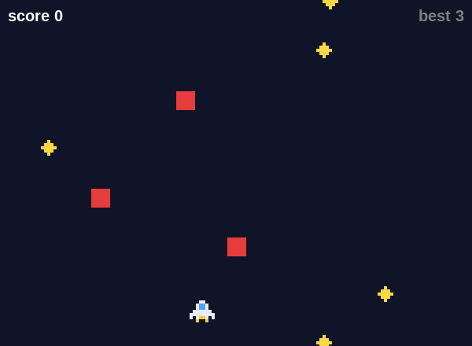
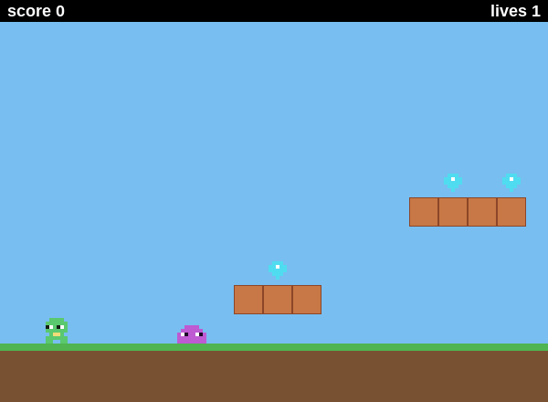
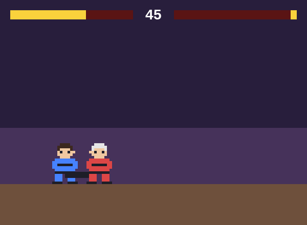
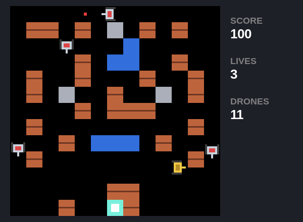
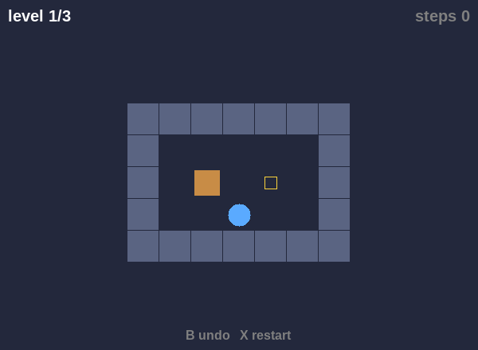
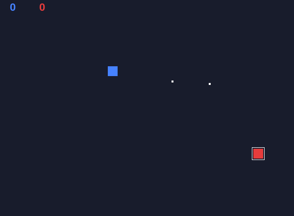

# Examples

Each folder is a complete small game and a starting point for a genre.
Start a new game from one: `python tool.py new my-game --from platformer`.
Play one on the PC: `python tool.py run platformer`.

| | Example | Genre and what it shows |
| --- | --- | --- |
|  | `minimal` — Star Catcher | Arcade. Title / play / game over, sprites from text, sound, saved high score |
|  | `platformer` — Gem Hopper | Side-scrolling platformer. Text tile level, gravity and jumping, camera, stomping enemies |
|  | `fighter` — Dojo Duel | One-on-one fighting. Punch, kick, block, health bars, rounds, CPU opponent |
|  | `tanks` — Core Guard | Top-down tank arena. Destructible walls, enemy waves, bullets, a base to defend |
|  | `puzzle` — Crate Keeper | Turn-based puzzle. Grid moves, several levels, undo |
|  | `netduel` — Net Duel | Multiplayer over Wi-Fi for 2-4 consoles. Host + join, state sync |

All examples are original games written for this kit; graphics are drawn in code.
